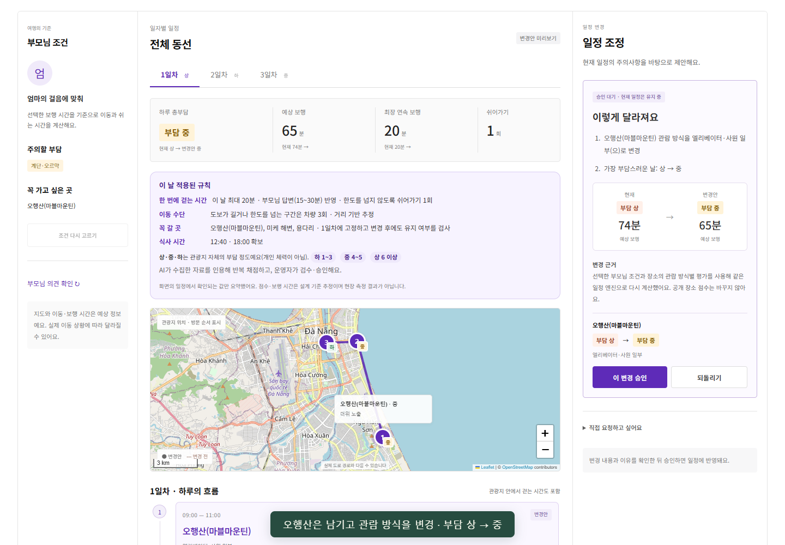
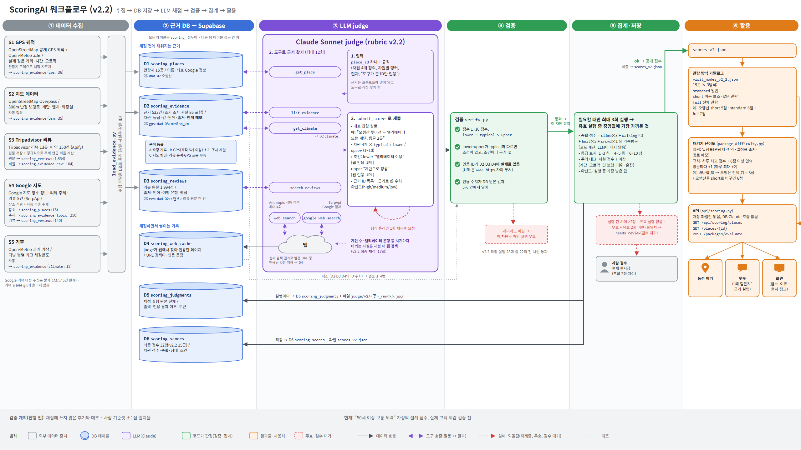
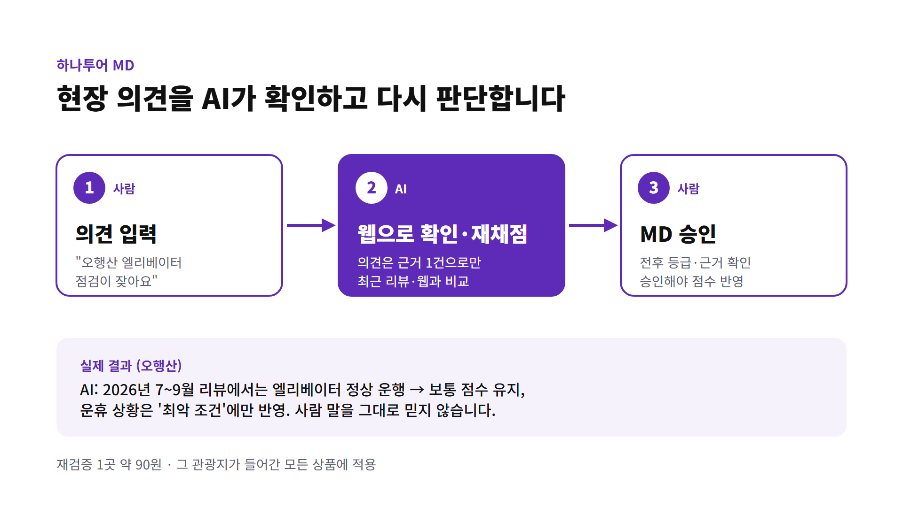
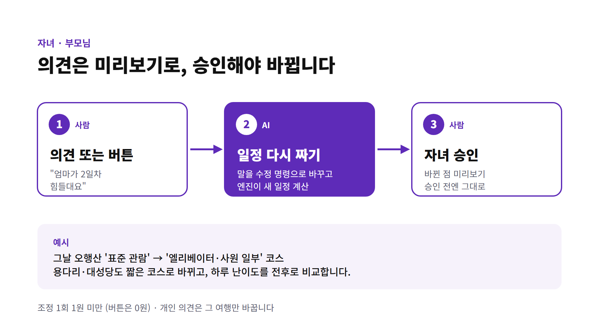
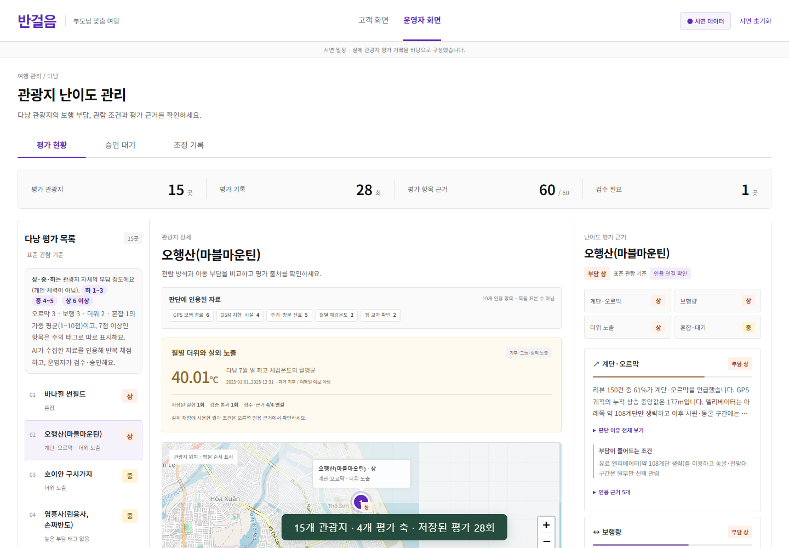
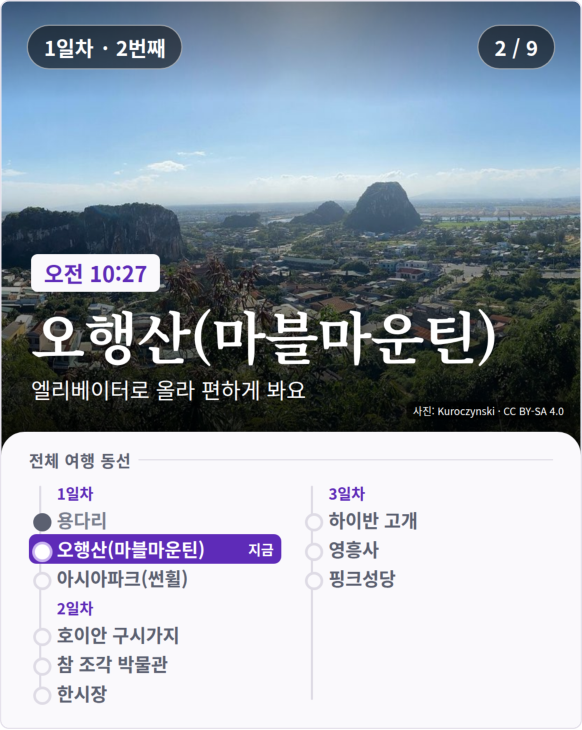

<div align="center">

# 반걸음

**부모님 일정이 무리인지, 출발 전에 알 수 있게**

*Bangeoreum scores how physically demanding each tourist spot is and builds family trip itineraries that fit parents' walking limits.*


[발표자료 (PDF)](docs/presentation/final/submitted/%5B발표용%5D_반걸음_발표자료_시연링크.pdf) · [시연 영상](docs/presentation/final/submitted/시연영상.mp4) · [발표 대본](docs/presentation/final/submitted/script.md) · [심사용 안내](docs/submission.md)



</div>

## 문제

효도여행을 준비할 때 가장 먼저 막히는 질문은 **"이 일정, 부모님께 무리일까?"** 입니다.

- 고령자의 **71.4%** 는 여행 정보를 가족에게서 얻습니다.
- 60대의 **63.3%** 는 패키지 여행을 고르고, 관광지에서 가장 큰 불편은 **경사와 계단**입니다.
- 결국 자녀가 일정표를 보고 판단해야 하지만, 그 판단 기준이 어디에도 없습니다.

패키지 일정표에는 차량 이동 시간만 있고 관광지 안에서 얼마나 걷는지는 없습니다. 지도는 장소를 선으로 잇기만 하고, AI 챗봇은 "부모님과 함께"를 문장으로만 반영합니다. **관광지가 얼마나 힘든지를 공통 수치로 만든 기준표**가 없기 때문입니다.

## 해결 방법

### 1. 관광지 난이도 점수

다낭 관광지 15곳마다 부담을 **1~10점**으로 매깁니다.

| 기준 | 계단·오르막 | 걷는 양 | 더위 | 혼잡 |
|---|:-:|:-:|:-:|:-:|
| 가중치 | 3 | 3 | 2 | 1 |

점수는 **하(1~3) · 중(4~5) · 상(6 이상)** 으로 보여 줍니다. 같은 오행산도 엘리베이터로 사원 일부만 보면 **5점**, 계단으로 정상까지 가면 **7점**입니다. 힘든 곳을 일정에서 빼는 대신 **보는 방식을 바꾸는** 선택지가 생깁니다.

### 2. 근거 기반 AI 채점과 코드 검증

점수는 GPS 궤적, 지도, 리뷰, 기후, 운영사 정보에서 모은 **근거 523건**에서 나옵니다. 근거마다 출처 등급과 한계를 함께 기록합니다.

1. **AI(Claude)** 가 근거를 읽고 채점하며, 점수마다 근거 번호를 붙입니다.
2. **코드**가 인용한 근거가 실제로 있는지, 숫자가 맞는지 대조합니다. 틀리면 그 점수는 무효입니다.
3. 결과가 흔들리면 **사람이 검수**합니다.

그 결과 **15곳 중 14곳이 검증을 통과**했고, 1곳은 사람 검수를 기다리고 있습니다.

<details>
<summary>채점 워크플로 전체 보기</summary>



</details>

### 3. 하루 부담과 동선 규칙

- 힘든 곳이 한날에 몰렸는지 봅니다. 바나힐 다음에 오행산 정상을 넣으면 하루 부담이 **8점**으로 상한 7을 넘고, 오행산을 엘리베이터 코스로 바꾸면 **6점**으로 내려옵니다.
- 여러 명이 함께 가면 **가장 천천히 걷는 분**에게 맞춥니다.
- 하루 **최대 3곳**, 점수 합이 피로 예산을 넘지 않게 묶습니다.
- 영업시간과 휴무를 지키고, 연속 보행이 한도에 닿으면 **25분 휴식**을 넣습니다.
- 꼭 가고 싶은 곳은 일정을 바꿔도 끝까지 남깁니다.

AI는 사용자의 요청을 정해진 수정 명령으로 바꾸기만 하고, 바뀐 일정은 **승인해야 반영**됩니다.

### 4. 사람의 확인 (Human-in-the-loop)

현실이 점수와 다를 때는 **사람이 말하고, AI가 확인하고, 사람이 승인**합니다.

| MD 피드백 | 가족 피드백 |
|:-:|:-:|
|  |  |
| "오행산 엘리베이터 점검이 잦다"는 말을 근거 하나로 받아 리뷰와 웹을 다시 확인하고, MD가 승인해야 점수가 바뀝니다. | "엄마가 2일차 힘들대요"라고 하면 일정을 다시 짜서 미리 보여 주고, 자녀가 승인하기 전까지 그대로 둡니다. |

## 화면

| 운영자 | 고객(자녀) | 부모님 |
|:-:|:-:|:-:|
|  |  |  |
| 관광지 점수와 근거, 관람 방식별 차이, 기후 자료를 검수합니다. | 부모님 조건으로 동선을 만들고 변경안을 비교해 승인합니다. | 승인된 일정을 큰 글씨의 여행지 카드로 받아 봅니다. 현재 장소와 전체 동선을 한 장에 보여 줍니다. |

## 비즈니스 모델

- **자녀**는 일정을 조정·승인하고 부모님께 공유합니다. 무료로 사용합니다.
- **여행사**는 기존 패키지를 넣어 부담을 검수합니다. 비용은 여행사가 냅니다.
- 관광지 1곳 채점 비용은 약 **$0.16**이며, 한 번 매긴 점수는 계속 쓸 수 있습니다.

## 한계와 다음 단계

- 지금 점수는 **보통 체력의 50세 이상**을 가정한 설계 점수입니다. 가이드와 MD가 직접 평가한 점수와 비교해 일치율을 공개할 계획입니다.
- 연령별 하루 상한(논문 기반)과 엔진의 가정값을 하나로 합칩니다.
- 지도 선은 방문 순서이며, 실제 도로 길찾기는 아직 연결하지 않았습니다.

## 빠른 실행

Python 3.10 이상, [uv](https://docs.astral.sh/uv/), Node.js와 npm이 필요합니다. 시연 데이터로 실행하므로 API 키나 DB 설정이 필요 없습니다.

```bash
uv sync
npm --prefix frontend ci
npm --prefix frontend run build
uv run uvicorn api.main:app --host 127.0.0.1 --port 8131
```

http://localhost:8131 에 접속합니다. 실제 DB 연결과 모델 채점은 [UI 재설계 안내](docs/ui-redesign.md)를 참고하세요.

## 프로젝트 구조

```
api/                  프로필·평가·일정·공유 API (FastAPI)
frontend/             고객·운영자·부모님 화면 (React + Vite + Leaflet)
src/scoring/          자료 수집·근거 연결·관광지 평가·검수 승인
src/planner/          조건 반영·일정 구성·식당 배치·변경안
src/profile/          부모님 프로필과 보행 조건
supabase/migrations/  DB 구조와 권한 변경 SQL
tests/                백엔드 회귀 검증
docs/                 설계 문서와 발표 자료
```

<details>
<summary><b>개발자 안내 (목업 · 로컬 실행 · Supabase · 테스트)</b></summary>

### 새 UI 실행

운영자 평가 근거 → 고객 동선 조정·승인 → 부모님 공유를 연결한 새 UI는 `frontend/`에 있습니다. 실행·권한·실제 연동과 시연 데이터의 차이는 [UI 재설계 안내](docs/ui-redesign.md)를 참고하세요. 기존 목업은 그대로 유지합니다.

### 목업 실행

날짜·가족 인원·부모님 프로필을 입력하고, 여러 날의 일정과 지도·전후 비교·여행 카드를 체험하는 목업입니다. 상단의 MD 작업실에서는 장소를 끌어 놓거나 버튼으로 예시 일정을 편집하고 고객 미리보기를 확인합니다. 별도 API 키 없이 실행하며, 장소·거리·항공·숙소는 시연용 예시입니다. 자세한 내용은 [목업 안내](docs/mockup.md)를 참고하세요.

```bash
uv run python mockup/serve.py
```

접속: http://localhost:8129/mockup/

### 로컬 실행

```bash
uv sync
cp .env.example .env
# .env에 Supabase 프로젝트 URL과 서버용 Secret key 입력
uv run uvicorn api.main:app --reload
```

API 문서: http://localhost:8000/docs

### Supabase 연결

Supabase 대시보드에서 프로젝트 URL과 서버용 Secret key를 확인하고
루트 `.env`의 `SUPABASE_URL`, `SUPABASE_SECRET_KEY`에 입력합니다.
배포 환경에서는 같은 이름의 환경변수를 설정합니다.
`.env`는 Git에서 제외되며, Secret key는 백엔드에서만 사용합니다.
이 키는 RLS를 우회하므로 사용자별 접근 권한은 API에서 확인해야 합니다.

공용 클라이언트는 최초 호출 시 생성하고 재사용합니다.
설정이 없어도 `/health`와 기본 서버는 실행됩니다.
키를 바꿨다면 서버를 다시 시작하세요.

```python
from src.supabase_client import get_supabase

db = get_supabase()
# 실제로 생성한 테이블 이름으로 변경
result = db.table("your_table").select("*").limit(10).execute()
```

FastAPI의 동기 라우트(`def`)에서는 `Depends(get_supabase)`로 주입할 수도 있습니다.
이 클라이언트는 서버 공용이므로 사용자 로그인이나 세션 변경에 사용하지 마세요.
테이블과 데이터 모델은 각 기능에서 별도로 정의합니다.
클라이언트 생성만으로 DB 연결이 검증되지는 않으며, 실제 테이블 조회로 확인합니다.

### 테스트

테이블 생성·변경·삭제는 PostgreSQL 연결을 사용합니다.
Supabase의 **Connect → Session pooler → URI**를 복사해
루트 `.env`의 `SUPABASE_DB_URL`에 넣으세요. `[YOUR-PASSWORD]`에는
프로젝트 DB 비밀번호를 입력합니다(API Secret key와 다름).
비밀번호에 `@`, `:`, `/` 같은 문자가 있으면 URI에 넣을 때 percent encoding이 필요합니다.

```bash
# 임시 테이블 생성 → 구조 변경 → 데이터 CRUD → 테이블 삭제
uv run python scripts/db.py smoke-test

# 임의의 SQL 파일 실행 (성공 시 commit, 실패 시 rollback)
uv run python scripts/db.py run path/to/migration.sql
```

이 명령은 개발자 터미널용이며 HTTP API로 노출하지 않습니다.

```bash
uv run pytest
```

</details>

## 팀

<a href="https://github.com/CheonjiKim"></a>
<a href="https://github.com/JANENAMMMM"></a>
<a href="https://github.com/hyroh5"></a>
<a href="https://github.com/jwlee0348"></a>

[@CheonjiKim](https://github.com/CheonjiKim) · [@JANENAMMMM](https://github.com/JANENAMMMM) · [@hyroh5](https://github.com/hyroh5) · [@jwlee0348](https://github.com/jwlee0348)
