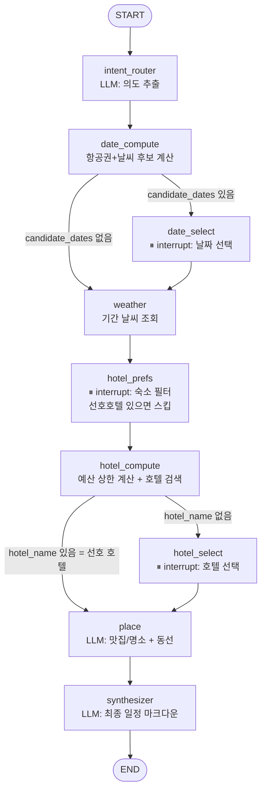

# Agent 분석 — `src/agent/` LangGraph 9-노드 여행 플래너

> 출처: `src/agent/graph.py`, `src/agent/state.py`, `src/agent/nodes/*.py`.
> 그래프는 `MemorySaver` 체크포인터로 컴파일되며, `interrupt()`를 쓰는 노드 3개(`date_select`, `hotel_prefs`, `hotel_select`)에서 사용자 입력을 기다렸다가 resume 된다.

## 1. 전체 흐름도

### 엣지 정리

| From | To | 종류 | 조건 |
|---|---|---|---|
| START | intent_router | 고정 | — |
| intent_router | date_compute | 고정 | — |
| date_compute | date_select / weather | 조건부 (`_route_after_date_compute`) | `state.get("candidate_dates")`가 truthy → `date_select`, 아니면 `weather` |
| date_select | weather | 고정 | — |
| weather | hotel_prefs | 고정 | — |
| hotel_prefs | hotel_compute | 고정 | — |
| hotel_compute | place / hotel_select | 조건부 (`_route_after_hotel_compute`) | `state.get("hotel_name")`이 truthy(선호 호텔) → `place`, 아니면 `hotel_select` |
| hotel_select | place | 고정 | — |
| place | synthesizer | 고정 | — |
| synthesizer | END | 고정 | — |

설계 원칙(`graph.py` docstring): `*_compute` 노드는 interrupt 없이 API 호출만 하고, `*_select` 노드는 state를 읽어 interrupt만 발생시킨다. resume 시 노드가 처음부터 재실행되더라도 외부 API가 두 번 호출되지 않도록 분리한 것이다.

## 2. State 스키마 (`state.py`)

`TravelIntent`: `destination`, `check_in`, `check_out`, `budget`, `adults`, `trip_nights`, `target_months`, `prefer_nonstop`, `preferred_hotel`, `flight_cost`

| 그룹 | AgentState 필드 |
|---|---|
| 입력 | `messages` (add_messages 리듀서) |
| Intent | `intent: TravelIntent`, `date_fixed: bool` |
| Date | `candidate_dates: list` |
| Weather | `is_rainy: bool`, `weather_summary: str` |
| Stay | `hotel_prefs`, `hotel_name`, `hotel_address`, `hotel_cost`, `remaining_budget`, `hotel_candidates` |
| Place | `restaurants`, `attractions`, `route_note` |
| Synth | `final_report`, `refinement_feedback` |

## 3. 노드별 상세

### 3.1 `intent_router` — `nodes/intent_router.py` (LLM)
- **역할**: 마지막 사용자 메시지에서 목적지·날짜·예산·인원·숙박일수·직항선호·선호호텔을 JSON으로 추출한다. 날짜가 확정되지 않았으면(월/시기만 언급하거나 미정) `date_fixed=False`로 둔다. 기본값은 목적지 "서울", 예산 500,000, adults 1, trip_nights 2.
- **입력**: `messages[-1].content`
- **출력**: `intent` (`flight_cost=0`으로 초기화), `date_fixed`

### 3.2 `date_compute` — `nodes/date_optimizer.py::make_date_compute_node`
- **역할**: 목적지 IATA 코드를 구하고 ICN 출발 항공권을 조회해 날씨 점수와 섞어 후보 TOP10을 만든다. `date_fixed=True`면 지정 날짜만 조회(`_fixed_date_search`)하고, False면 `target_months`(없으면 향후 3개월)를 탐색한다(`_flexible_search`). 출발 시각이 없는 후보는 SerpAPI로 채운다.
- **Fallback**: IATA 코드가 없거나 국내선이거나 항공 조회에 실패하면 `_weather_only_candidates`로 날씨만 보고 날짜를 확정한다. 이때 `candidate_dates=[]`가 되므로 흐름은 `weather`로 간다.
- **입력**: `intent` (`destination`, `trip_nights`, `prefer_nonstop`, `target_months`, `check_in/out`), `date_fixed`
- **출력**: 정상이면 `candidate_dates` (TOP10: `check_in`, `check_out`, `flight_price`, `weather_summary`, `weather_full`, `score`, `reason`, `stops`, `airline_name`, `departure_time` 등). Fallback이면 `candidate_dates=[]`, `intent`(날짜 확정본), `date_fixed=True`, `weather_summary`

### 3.3 `date_select` — `nodes/date_optimizer.py::make_date_select_node` (⏸ interrupt)
- **역할**: `{"type": "date_selection", "candidates": [...]}`로 interrupt를 걸어 사용자가 번호를 고르게 한다. 잘못된 값이면 1번을 쓴다. 고른 날짜로 intent를 갱신하고 `flight_cost = flight_price × adults`를 계산한다. `weather_full`에 강우 1.0mm 초과인 날이 있으면 `is_rainy`로 판정한다.
- **입력**: `intent`, `candidate_dates`
- **출력**: `candidate_dates` (TOP3로 축소), `intent` (`check_in`, `check_out`, `flight_cost` 갱신), `date_fixed=True`, `weather_summary`, `is_rainy`. 후보가 없으면 `date_fixed=True`만 반환한다(방어 코드).

### 3.4 `weather` — `nodes/weather_node.py`
- **역할**: 체크인부터 체크아웃까지 하루씩 날씨를 조회한다(`src.weather.get_weather`). 강수확률 50% 이상이거나 강우가 1mm를 넘는 날이 하루라도 있으면 `is_rainy=True`.
- **스킵/재사용**: `check_in`이 없으면 기본값을 반환한다. `weather_summary`가 이미 있으면(date 노드에서 계산했으면) `{}`를 반환하고 다시 조회하지 않는다.
- **입력**: `intent` (`destination`, `check_in`, `check_out`), `weather_summary`
- **출력**: `is_rainy`, `weather_summary` (재사용하는 경우에는 출력 없음)

### 3.5 `hotel_prefs` — `nodes/stay_node.py::make_hotel_prefs_node` (⏸ interrupt)
- **역할**: Google Hotels 필터(`HOTEL_PREFS_SCHEMA`: sort_by, min_rating, hotel_class, amenities, free_cancellation, vacation_rentals)를 interrupt(`type: hotel_prefs`)로 묻고 `_parse_prefs`로 정규화한다. `intent.preferred_hotel`이 있으면 interrupt 없이 넘어간다.
- **입력**: `intent.preferred_hotel`
- **출력**: `hotel_prefs` (스킵하면 `{}`)

### 3.6 `hotel_compute` — `nodes/stay_node.py::make_hotel_compute_node`
- **역할**: `_budget_caps`로 숙박 상한을 계산한다. 항공비가 있으면 (예산 − 항공비) × 0.9, 없으면 예산 × `HOTEL_BUDGET_RATIO`이고, 이를 박수로 나눠 1박 상한을 정한다. 선호 호텔이 있으면 그 호텔로 확정하고, 없으면 `search_hotel_candidates`로 후보를 최대 10개 검색한다(실패 시 mock 데이터).
- **입력**: `intent` (`budget`, `trip_nights`, `adults`, `flight_cost`, `preferred_hotel`, `destination`), `hotel_prefs`
- **출력**:
  - 선호 호텔: `hotel_name`, `hotel_address=""`, `hotel_cost=0`, `remaining_budget`, `hotel_candidates=[]` → `place`
  - 검색: `hotel_candidates`, `hotel_name=""` → `hotel_select`

### 3.7 `hotel_select` — `nodes/stay_node.py::make_hotel_select_node` (⏸ interrupt)
- **역할**: 후보 목록으로 interrupt(`type: hotel_selection`)를 걸어 사용자가 하나를 고르게 한다. 잘못된 값이면 1번을 쓴다. 잔여 예산은 `budget − flight_cost − hotel_cost`로 계산한다.
- **입력**: `intent`, `hotel_candidates`
- **출력**: `hotel_name`, `hotel_address`, `hotel_cost`, `remaining_budget`

### 3.8 `place` — `nodes/place_node.py::make_place_node` (LLM)
- **역할**: 박수에 맞춰 맛집/명소 개수를 정하고(`_place_counts`), 비가 오면 실내 위주로 검색 쿼리를 만든다(`_build_queries`). Naver/Google 장소 검색을 병렬로 돌리고 LLM으로 큐레이션한다(`_curate_with_llm`). 마지막으로 호텔 좌표에서 출발하는 nearest-neighbor(하버사인 거리) 동선 요약을 만든다. API를 쓸 수 없으면 mock 데이터를 쓴다.
- **입력**: `intent`, `is_rainy`, `hotel_name`, `hotel_address`
- **출력**: `restaurants`, `attractions`, `route_note`

### 3.9 `synthesizer` — `nodes/synthesizer_node.py` (LLM)
- **역할**: 수집한 정보(예산 내역, 날씨, 후보 날짜, 숙소, 장소, 동선)를 프롬프트로 묶어 Solar Pro3에 넘기고 GFM 표 기반 한국어 마크다운 일정을 만든다. `refinement_feedback`이 있으면 수정 요청 지시를 시스템 프롬프트에 덧붙인다(장소 목록 안에서만 조정). 진행 상황은 `progress.emit`으로 SSE 큐에 보낸다.
- **입력**: `intent`, `candidate_dates`, `hotel_name`, `hotel_address`, `hotel_cost`, `remaining_budget`, `restaurants`, `attractions`, `route_note`, `weather_summary`, `refinement_feedback`
- **출력**: `final_report`

## 4. 노드 × State 필드 읽기/쓰기 매트릭스

R = 읽기, W = 쓰기, (W) = 특정 분기에서만 쓰기

| 필드 | intent_router | date_compute | date_select | weather | hotel_prefs | hotel_compute | hotel_select | place | synthesizer |
|---|---|---|---|---|---|---|---|---|---|
| messages | R | | | | | | | | |
| intent | W | R,(W) | R,W | R | R | R | R | R | R |
| date_fixed | W | R,(W) | W | | | | | | |
| candidate_dates | | W | R,W | | | | | | R |
| weather_summary | | (W) | W | R,(W) | | | | | R |
| is_rainy | | | W | (W) | | | | R | |
| hotel_prefs | | | | | W | R | | | |
| hotel_candidates | | | | | | W | R | | |
| hotel_name | | | | | | W | W | R | R |
| hotel_address | | | | | | (W) | W | R | R |
| hotel_cost | | | | | | (W) | W | | R |
| remaining_budget | | | | | | (W) | W | | R |
| restaurants / attractions / route_note | | | | | | | | W | R |
| refinement_feedback | | | | | | | | | R |
| final_report | | | | | | | | | W |

## 5. 참고 사항
- **Interrupt 지점 3곳**: `date_selection`, `hotel_prefs`, `hotel_selection`. 클라이언트는 `Command(resume=...)`로 번호나 prefs 값을 넘겨 재개한다.
- **LLM 사용 노드**: `intent_router`, `place`, `synthesizer`. 셋 다 `build_graph()`에서 만든 같은 `get_llm(model="solar-pro3")` 인스턴스를 쓴다.
- **Fallback 경로에서 생기는 미세한 차이**: 날씨 기반 fallback(`_weather_only_candidates`)은 `is_rainy`를 쓰지 않는다. 그런데 `weather_summary`가 이미 채워져 있어서 `weather` 노드가 재사용 분기로 `{}`를 반환하므로, `is_rainy`가 설정되지 않은 채(→ `place`에서 기본값 False) 진행된다.
- `refinement_feedback`은 그래프 안의 어느 노드도 쓰지 않는다. 그래프 바깥(API 레이어)에서 state를 갱신해 synthesizer를 다시 돌리는 용도로 보인다.
