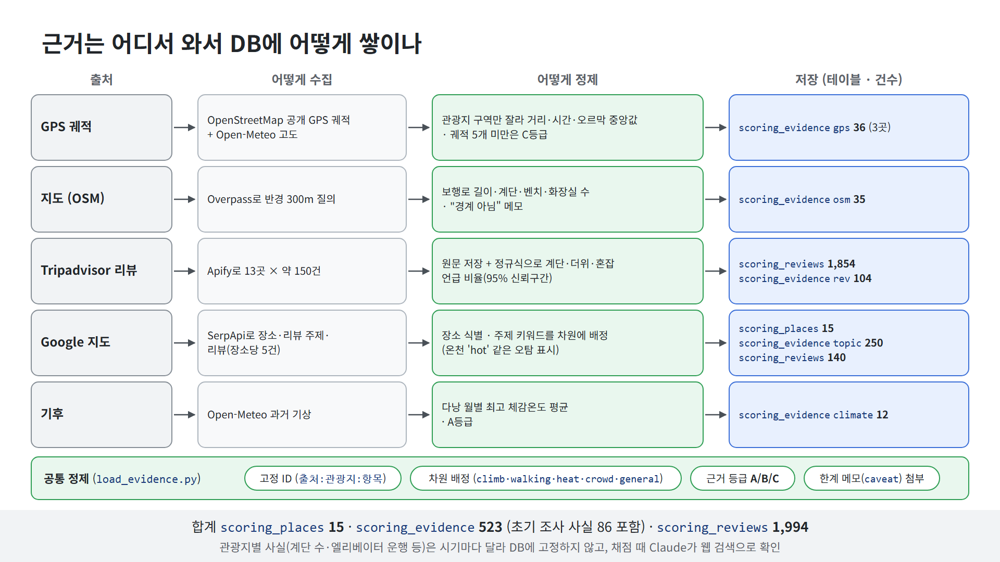
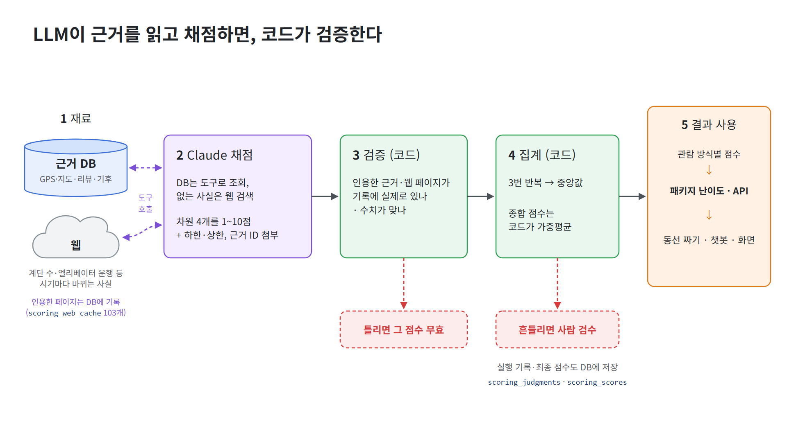

# ScoringAI — 관광지 여행 난이도 평가 (최종 문서)

> **이 문서 하나로 ScoringAI의 현재 상태를 파악할 수 있게 정리했다.** 세부는 링크로 연결한다.
> 담당: 남재은 · 브랜치 `JANENAMMMM/scoring-ai` · 기준: 2026-11-03 · 현재 버전 **v2.1**
> 과거 변경 이력: [CHANGELOG.md](CHANGELOG.md)

---

## 1. 한 줄 요약

다낭권 관광지 15곳의 **여행 난이도를 1~10점 + 관람 방식별 점수**로 매기고, 점수마다 **근거(출처 ID·URL)** 를 붙인다. 상품 일정을 넣으면 **일차별·패키지 난이도**와 "관람 방식을 바꾸면 몇 점으로 내려가는지"를 계산한다.

## 2. 왜 이렇게 만들었나 (설계 원칙 3개)

| 원칙 | 내용 | 이유 |
|---|---|---|
| 근거는 DB에 | 지도·GPS·리뷰·기후를 출처와 한계 메모까지 저장 | 멘토 지적: "그 정보를 어디서 구하나" |
| 해석은 LLM judge, 합산은 코드 | Claude가 도구로 근거를 조회·웹 검색해 차원 점수를 내고, 종합 점수는 코드가 가중평균 | 관광지 범위·실제 관람 경로(정상까지 안 갈 수 있음, 케이블카가 대신함)는 규칙으로 판단 불가 |
| 인용 없으면 무효 | 인용한 근거 ID가 DB에 없거나 수치가 다르면 그 차원은 무효, 3회 실행 중앙값 | LLM끼리도 등급이 8/15만 일치 → 흔들림 억제 장치 필요 |

## 3. 구조





<details><summary>텍스트 구조도</summary>

```
수집(src/scoring/collect)  ─▶  근거 DB  Supabase scoring_* 6개 테이블
  Google 식별·주제, Tripadvisor 리뷰,      places 15 · evidence 523 · reviews 1,994
  GPS 궤적, 기후, OSM(부분), 초기 조사 사실  web_cache · judgments · scores
                                  │ 도구 호출
                                  ▼
                 LLM judge (Claude Sonnet, rubric v2.1)
                 get_place · list_evidence · search_reviews · get_climate · web_search · google_web_search
                 ① 대표 관람 경로 → ② 차원별 typical/lower/upper + 조건 + 근거 ID
                                  │
                                  ▼
                 검증 코드: 인용 실재·수치 일치, 3회 중앙값, 폭 >2 → needs_review
                                  │
                                  ▼
       점수(scores_v2.json) ─▶ 관람 방식 카탈로그(visit_modes_v2_1.json) ─▶ 패키지 난이도 · API
```

</details>

- 상세 명세: [judge_spec_v2.md](spec/judge_spec_v2.md) · 근거·일정 연결 규칙: [evidence_workflow.md](spec/evidence_workflow.md)
- 전체 흐름을 그림 한 장으로 그리기 위한 설명서: [workflow_diagram.md](workflow_diagram.md) · 팀원 설명 대본(+질의응답 부록): [workflow_script.md](workflow_script.md)

### 3-1. DB에 저장된 것 (Supabase, 2026-11-03 기준 행 수)

모든 테이블 이름은 `scoring_`으로 시작한다. `src/scoring/db.py`는 이 접두어가 아닌 테이블은 읽거나 쓰지 않으며, DROP·TRUNCATE·ALTER 문도 없다. 다른 팀원 테이블(`hello_world_test` 등)은 건드리지 않는다.

| 테이블 | 행 | 한 행이 뜻하는 것 | 주요 열 | 누가 쓰나 |
|---|---|---|---|---|
| `scoring_places` | 15 | 관광지 1곳 | `id`(dad-01~15), 한/영 이름, 좌표, `google_place_id`, `tripadvisor_url`, `meta`(Google 유형·운영시간·평점·리뷰 수·주소) | `load_evidence.py` |
| `scoring_evidence` | 523 | 근거 1건(수치나 사실 하나) | `id`, `place_id`, `dimension`(climb·walking·heat·crowd·general), `basis`(등급 A·B·C), `metric`, `value`, `unit`, `text`(사람이 읽는 문장), `source`, `source_url`, `caveat`(한계 메모) | `load_evidence.py` |
| `scoring_reviews` | 1,994 | 리뷰 원문 1건 | `id`, `place_id`, `source`, `lang`, `date`, `trip_type`(가족·커플 등), `rating`, `text` | `load_evidence.py` |
| `scoring_web_cache` | 103 | judge가 웹 검색으로 찾아 **실제로 인용한** 페이지 1개 | `id`(`web:`+URL 해시), `place_id`, `query`, `url`, `title`, `excerpt`(인용 문장, 최대 2,000자) | `run_judge.py` (채점 중 자동) |
| `scoring_judgments` | 67 | judge 실행 1회의 원본 출력 | `run_id`, `place_id`, `model`, `rubric_version`, `run_index`, `output_json`, `citations_valid`, `usage`(토큰·도구 호출 수·검증 보고서) | `run_judge.py` |
| `scoring_scores` | 17 | 관광지 × 루브릭 버전별 최종 점수 | `dimensions`(차원별 typical·lower·upper), `composite_*`, `grade_display`, `confidence`, `status`, `conditions_json`(조건·플래그·대표 경로·설명 출처) | `run_judge.py` |

- `scoring_judgments` 67회 = v2.1 65회(유효 56, 무효 9) + v2.0 시험 2회. `scoring_scores` 17행 = v2.1 15곳 + v2.0 시험 2곳.

**근거 523건의 구성** (근거 ID 접두어 = 출처)

| ID 접두어 | 건수 | 등급 | 출처와 만드는 방법 | 주의점(`caveat`에 기록) |
|---|---|---|---|---|
| `fact:<곳>:<항목>` | 86 | B | **초기 참고용.** 1일차에 AI가 관광청·UNESCO·백과·블로그를 웹 조사해 정리한 사실(실외 노출, 노면, 대체 이동수단 등). 계단 수는 오행산 1곳(블로그 추정)뿐이고 공식 수치는 드묾. 시기마다 바뀌는 사실이라 새 출처로는 쓰지 않고, 채점 때 judge가 웹 검색으로 확인한다. `data/scoring/derived/site_facts.json` | 출처 유형·신뢰도와 URL 목록 |
| `gps:<곳>:<지표>` | 36 | B(궤적 5개 이상)·C | OSM에 공개된 GPS 궤적을 관광지 구역으로 잘라 보행 거리(중앙값·p25·p75), 소요 시간, 누적 오르막, 속도 계산. 고도는 Open-Meteo | 궤적 수 n, 5개 미만이면 "표본 부족" |
| `osm:<곳>:<지표>` | 35 | C | OpenStreetMap Overpass로 반경 300m 안의 보행로 길이, 계단, 엘리베이터, 벤치, 화장실, 고도 범위 | 관광지 경계가 아니라 300m 반경, 태그 누락 많음 |
| `rev:<곳>:sig_<주제>` | 104 | C | Tripadvisor 리뷰(13곳 × 약 150건)에서 정규식으로 계단·보행·더위·혼잡 등 언급 비율과 95% 신뢰구간 계산 | 정규식 정밀도(계단 약 90%, 혼잡 약 70%) |
| `topic:<곳>:<키워드>` | 250 | C | Google 지도가 자동 추출한 리뷰 주제와 언급 수(SerpApi) | 자동 추출, 온천의 'hot' 같은 오탐 |
| `climate:<월>` | 12 | A | Open-Meteo 과거 기상 자료로 다낭 월별 일 최고 체감온도 평균 | 다낭 시내 기준, 바나힐 같은 산지는 더 낮음 |

- 차원별로는 climb 80 · walking 88 · heat 51 · crowd 18 · general 286건이다. general은 주로 Google 주제 키워드처럼 어느 차원인지 정해지지 않은 항목이다.
- **리뷰 1,994건**: Tripadvisor 1,854건(13곳) + Google 140건(15곳, SerpApi로 장소당 최대 5건씩 영어·한국어). 원문은 저작권 때문에 git에 올리지 않고 DB에만 둔다.
- 근거 ID 규칙: 같은 사실은 다시 넣어도 같은 ID가 되도록 `출처:관광지:항목` 형태의 고정 문자열을 쓴다. judge가 인용하는 값이 이 ID다.

### 3-2. LLM이 근거를 읽고 검증받는 방식

1. **채점 시작**: `run_judge.py`가 관광지 ID 하나를 주고 Claude(`claude-sonnet-5-5`)를 부른다. 시스템 프롬프트에는 차원 정의, 차원별 앵커, 절차, 근거 규칙만 있고 근거 자체는 없다.
2. **도구로 근거 읽기** (도구 호출 최대 12회, 넘으면 제출 강제)
   - `get_place` → `scoring_places` 기본 정보
   - `list_evidence(place_id, dimension)` → `scoring_evidence`의 근거 목록(ID·값·caveat 포함)
   - `search_reviews(place_id, keyword)` → `scoring_reviews` 원문 키워드 검색, 최대 8건
   - `get_climate(month)` → `climate:<월>` 근거
   - `web_search`(Anthropic 서버 검색, 최대 4회) · `google_web_search`(SerpApi Google 웹 결과) → DB에 없는 계단 수·경로 길이·셔틀 범위 확인
3. **제출**: `submit_scores` 도구로만 제출한다. 대표 관람 경로, 차원별 typical·lower·upper, lower·upper 조건(조건마다 근거 ID), 근거 ID 목록, 근거로 쓴 수치(`numeric_claims`), 확신도. 형식이 틀리면(점수를 `dimensions` 밖에 두는 등) 한 번 다시 제출하게 한다.
4. **웹 인용 저장**: 출력에 나온 URL 중 실제 검색 결과로 돌아온 URL만 `scoring_web_cache`에 `web:` ID로 저장한다. 검색 결과에 없던 URL은 저장하지 않으므로 다음 단계에서 무효가 된다.
5. **검증** (`verify.py`, 코드로만 판정, 차원별)
   - 점수가 1~10 정수이고 lower ≤ typical ≤ upper인지
   - lower·upper가 typical과 다르면 조건이 있고, 조건마다 근거 ID가 있는지
   - 인용한 ID가 전부 DB(evidence·reviews·web_cache)에 있는지. URL은 `www.`·http/https·끝 슬래시 차이를 무시하고 비교
   - `numeric_claims`의 수치가 DB 원본 값과 5% 안에서 일치하는지
   - 하나라도 어기면 **그 차원은 이번 실행에서 무효**
6. **집계**: 3회 실행 중 유효한 실행만 모아 차원별 중앙값을 낸다. 실행 간 차이가 2점을 넘거나, 유효 실행이 없거나, 무효 실행이 있으면 `needs_review`(검수 대기)로 표시한다. 종합 점수는 코드가 가중평균으로 계산하고, 확신도는 3회 중 가장 낮은 값을 쓴다.
7. **저장**: 실행마다 `scoring_judgments`와 `data/scoring/judge/v2/<곳>_run<k>.json`, 최종은 `scoring_scores`와 `data/scoring/scores_v2.json`. 이 점수에서 관람 방식 카탈로그(`visit_modes_v2_1.json`)를 만들고, API와 패키지 난이도는 이 파일만 읽는다(DB·Claude 호출 없음).

## 4. 점수 체계

- **차원 4개** (각 1~10, 높을수록 힘듦): 계단·오르막(climb) / 보행량(walking) / 더위(heat) / 혼잡(crowd)
- **종합** = climb 3 · walking 3 · heat 2 · crowd 1 가중평균 (코드 계산). 표시 등급 1~3 하 · 4~6 중 · 7~10 상
- **차원별 앵커**: climb 박물관 1~2 / 호이안 1 / 오행산 정상 8 · walking 2 / 5 / 6 · heat 2 / 7 / 7 · crowd 리뷰 혼잡 20%대 = 5
- **관람 방식 3개**: `standard`(일반) · `short`(이동 보조·짧은 관람) · `full`(전체 관람). climb·walking에 lower/upper 조건을 적용하고 heat·crowd는 typical 유지 → [visit_modes_package.md](spec/visit_modes_package.md)

## 5. 결과 (15곳)

| 관광지 | 종합(일반/하한/상한) | 등급 | 상태 | | 관광지 | 종합 | 등급 | 상태 |
|---|---|---|---|---|---|---|---|---|
| 오행산 | 7 / 4 / 8 | 상 | ok | | 미케 해변 | 3 / 2 / 5 | 하 | ok |
| 바나힐 | 6 / 4 / 8 | 중 | ok | | 아시아파크 | 3 / 2 / 5 | 하 | ok |
| 누이탄타이 온천 | 5 / 3 / 6 | 중 | ok | | 하이반 고개 | 3 / 2 / 5 | 하 | ok |
| 미선 유적지 | 5 / 3 / 6 | 중 | ok | | 호이안 야시장 | 3 / 3 / 5 | 하 | ok |
| 호이안 구시가지 | 4 / 3 / 5 | 중 | ok | | 껌탄 코코넛 마을 | 3 / 2 / 5 | 하 | 검수 대기 |
| 영흥사 | 4 / 3 / 5 | 중 | ok | | 용다리 | 2 / 1 / 4 | 하 | ok |
| 한시장 | 4 / 2 / 5 | 중 | ok | | 다낭 대성당 | 2 / 2 / 4 | 하 | ok |
| | | | | | 참 조각 박물관 | 2 / 1 / 3 | 하 | 검수 대기 |

- 원본: [`data/scoring/scores_v2.json`](../../data/scoring/scores_v2.json) · 관람 방식: [visit_modes_v2_1.json](../../data/scoring/visit_modes_v2_1.json)
- 예: 오행산 `short` = 엘리베이터 이용·사원 일부 → 5점 / `full` = 계단으로 정상까지 → 7점

## 6. 패키지 난이도 (상품기획자용)

- 하루 난이도 = 그날 최고 관광지 점수 + **6점 이상 방문이 연속한 쌍마다 +1**(하루 최대 +2, 상한 10)
- 패키지 결과 = 일차별 점수, 최고(`peak`), 평균(`mean`), 사용한 일정표 근거, 검수 대기 관광지
- 예시: 1일차 바나힐(6) → 오행산 전체(7) = **8점**. 오행산을 `short`(5)로 바꾸면 **6점**
- 일정 입력에는 `place_id`, `mode`, `source_ref`(일정표 쪽·행), `route_note`가 필수. 관람 방식은 자동 추정하지 않음
- 연속 가산은 방문 순서 기준의 **시뮬레이션 규칙**(실제 휴식·이동 시간 미반영)

## 7. 사용 방법

```bash
uv run pytest -q                                              # 테스트 30개
uv run python -m src.scoring.run_judge --sites dad-02 --runs 3 --replace   # 재채점(비용 발생, 기존 점수 덮어쓰기는 --replace 필요)
uv run python -m src.scoring.run_itinerary <일정.json> --output <결과.json>  # 패키지 난이도
uv run python -m src.scoring.run_review_validation docs/scoring-ai/validation/heldout_review_annotations.csv --output <보고서.json>
```

**API** (`api/scoring.py`, 저장된 v2.1 카탈로그를 읽음, DB 쓰기·API 비용 없음)

| 엔드포인트 | 내용 |
|---|---|
| `GET /api/scoring/places` | 15곳 목록·방식별 점수 |
| `GET /api/scoring/places/{place_id}` | 차원 점수·근거 ID·조건 |
| `POST /api/scoring/packages/evaluate` | 일정 JSON → 일차별·패키지 난이도 |

**다른 담당이 쓰는 법**: 동선 짜기 = 방식별 점수와 패키지 함수 · 챗봇 = 조건·근거 ID로 "왜 힘든지" 설명 · UI = 점수, 힘든 이유 1~2개, 부담을 줄이는 조건, 출처 링크, 검수 상태만 노출

## 8. 검증 현황

| 검증 | 결과 | 문서 |
|---|---|---|
| 인용 검증 | 재실행 18/18 통과, 최종 13곳 ok · 2곳 검수 대기 | [CHANGELOG](CHANGELOG.md) |
| v1 규칙 엔진과 비교 | 13곳 중 8곳 등급 일치. 차이는 v2가 웹 검색으로 근거를 보강한 경우(영흥사 계단, 누이탄타이 경사) | [judge_comparison.md](archive/v1-rule-engine/judge_comparison.md) |
| 공개 후기 반례 탐색 | 오행산·바나힐·미선 방식별 차이는 후기와 일치. **참 조각 박물관 더위(냉방 부재), 용다리 쇼·야시장 혼잡은 과소 평가 가능 → 재검토 우선** | [review_spotcheck_2026-11-03.md](validation/review_spotcheck_2026-11-03.md) |
| 채점 미사용 후기 대조 | 양식·스크립트 준비, 작성 전 | [heldout_review_annotations.csv](validation/heldout_review_annotations.csv) |
| 사람 기준셋 | 양식 준비, 작성 전 (팀원 2명 × 30분) | [gold_set_template.md](validation/gold_set_template.md) |

> **주의**: 현재 점수는 "보통 체력 50세 이상"을 가정한 **설계 점수**이며, 실제 고객 체감으로 검증된 값은 아니다. 출시 전 가이드·상품기획자가 AI 점수를 보지 않고 10~15곳을 평가해 ±1점 일치율을 공개해야 설득력이 생긴다.

## 9. 데이터 출처와 한계

| 출처 | 확보 | 해커톤 | 하나투어 운영 |
|---|---|---|---|
| Google Places 공식 | 15곳 식별, 리뷰 주제 언급 수 | O | O (리뷰는 장소당 5건 한계) |
| SerpApi | 식별·주제, Google 웹 검색 도구 | △ | X (비공식) |
| Tripadvisor (Apify) | 13곳 × 150건 | △ 시연용 | X |
| OSM 공개 GPS 궤적 | 실보행 3곳 | O | O |
| 기후 | 다낭 월별 체감온도 | O | O |
| 관광지별 사실 | 채점 때 judge가 웹 검색(31회, 인용 103개). 초기 조사 86건은 참고용 | O | O |
| 하나투어 자체 후기·가이드 | — | — | **최우선** |

- 법적 검토·출처별 판단: [design_b_serpapi.md §1-6](archive/v0-design/design_b_serpapi.md) · 데이터 조사 보고서: [research/report_data_sources.md](research/report_data_sources.md)
- Google 리뷰 대량 수집은 불가(2026-02 비로그인 제한 보기, SerpApi 미해결 이슈, 자동화 브라우저 로그인 차단)

## 10. 남은 일

1. **재검토 우선 3곳**: 참 조각 박물관 더위, 용다리(쇼 관람 방식 분리), 호이안 야시장 혼잡
2. **사람 검증**: 사람 기준셋 + 채점 미사용 후기 대조 → ±1점 일치율
3. **하나투어 일정표 연결**: 공개 상품 2~3개를 `itin:` 근거로 넣고 일정 기준 점수 산출
4. 정리: 미커밋 변경 커밋, `osm_features.json`(중단된 4곳 측정) 폐기 여부 결정, main 병합 PR

## 11. 파일 지도

| 구분 | 위치 |
|---|---|
| 판정 | `src/scoring/judge.py`, `verify.py`, `run_judge.py`, `provenance.py`, `google_web_search.py` |
| DB·근거 | `src/scoring/db.py`, `load_evidence.py` |
| 관람 방식·패키지 | `src/scoring/visit_modes.py`, `package_difficulty.py`, `itinerary.py`, `run_itinerary.py` |
| 후기 검증 | `src/scoring/review_validation.py`, `run_review_validation.py` |
| v1 규칙 엔진 (기준선) | `src/scoring/engine.py`, `features.py`, `validate.py` · [engine_spec.md](archive/v1-rule-engine/engine_spec.md) |
| 수집 | `src/scoring/collect/` (GPS, OSM, 대안 지표) |
| API | `api/scoring.py` |
| 데이터 | `data/scoring/` (derived 수집 결과, judge 실행 기록, scores_v2.json) |
| 지난 문서 (참고용) | [archive/](archive/README.md) — v0 설계안, v1 규칙 엔진, 작업 로그 |
