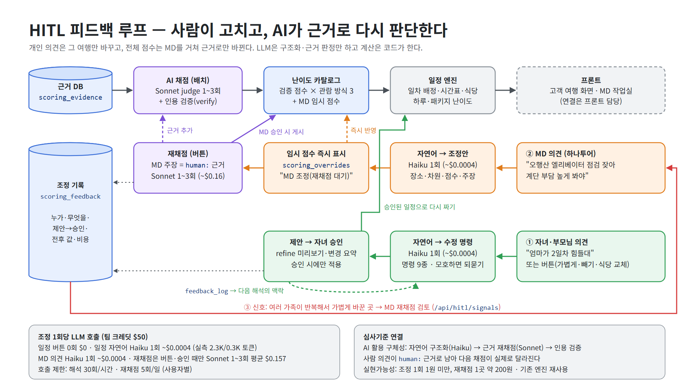

# HITL 피드백 루프 — 사람이 고치고, AI가 근거로 다시 판단한다

> 2026-11-04 · 남재은 · 브랜치 `feat/scoring-hitl` · 그림 생성: `python docs/scoring-ai/assets/gen_hitl.py`

## 원칙

- **개인 의견은 그 여행만 바꾸고, 전체 점수는 MD를 거쳐 근거로만 바뀐다.** 자녀·부모님 피드백이 공용 점수를 직접 바꾸지 않는다.
- LLM은 자연어를 구조로 바꾸고(Haiku), 근거를 보고 판정한다(Sonnet judge). 점수 합산·일정 계산은 코드가 한다.
- 모든 조정은 **제안 → 승인** 순서다. 승인 전에는 일정이 바뀌지 않는다(기존 `/refine`은 바로 적용했음).

## 이미 있던 것 (planner, 이지원·노희윤)

| 모듈 | 하는 일 |
|---|---|
| `src/planner/feedback.py` | 자연어 → 수정 명령 9종 (Haiku 5.5 1회, strict 도구, 모호하면 되묻기) |
| `src/planner/edit.py` | 명령을 `state`에 반영하고 엔진으로 다시 짬. 하나라도 틀리면 적용 안 함, 변경 요약 생성 |

새로 만든 것은 ① 점수 조정 경로 ② 승인 단계 ③ 기록과 "다음 판단" 반영 통로다.

## 세 갈래

| | 누가 | 흐름 | 다음 판단에 반영되는 방식 |
|---|---|---|---|
| ① 일정 | 자녀(부모님 의견 포함) | 자연어/버튼 → 명령 → `refine` 제안 → 자녀 승인 | 승인 요약이 `state.feedback_log`에 남아 다음 자연어 해석의 맥락이 됨 |
| ② 점수 | MD | 자연어 → 조정안(장소·차원·점수·주장) → 임시 점수 즉시 표시 → [재채점] MD 주장을 `human:` 근거로 넣고 그 장소만 재채점 → MD 승인 시 게시 | 근거 DB에 남아 이후 모든 채점에서 judge가 웹으로 교차 확인하고 인용 |
| ③ 신호 | 시스템 → MD | 서로 다른 일정 3개 이상에서 같은 관광지를 가볍게(short·제외) 바꾸면 재채점 검토 후보 | MD가 ②로 넘김 |

## API (`api/hitl.py`)

| 메서드 | 경로 | 설명 |
|---|---|---|
| POST | `/api/hitl/itinerary/preview` | `{itinerary, commands?, feedback?, actor_role, actor_id}` → `{feedback_id, proposal}` |
| POST | `/api/hitl/score/preview` | MD 자연어 `{text, actor_id}` → 조정안·전후 점수·임시 점수 |
| POST | `/api/hitl/score/{id}/rejudge` | 재채점(스테이징, 게시 안 함) |
| POST | `/api/hitl/{id}/approve` | 일정: 확정 일정 반환 / 점수: 게시·카탈로그 재생성·임시 점수 해제 |
| POST | `/api/hitl/{id}/reject` | 거절(점수면 임시 점수·`human:` 근거 삭제) |
| GET | `/api/hitl/feedback?place_id=` · `/api/hitl/signals` | 기록·신호 |

- `GET /api/scoring/places`와 일정 엔진은 **검증 점수 + 활성 임시 점수**를 읽는다(`load_catalog`). 임시 점수가 반영된 곳은 `hitl_pending`과 "MD 조정값(재채점 대기)" 안내가 붙는다.
- MD 엔드포인트: 환경변수 `HITL_MD_TOKEN`이 있으면 `X-MD-Token` 헤더 필요. 호출 제한: 해석 30회/시간, 재채점 5회/일(사용자별), `/api/planner/refine` 자연어 60회/시간(서버 전체).

## 저장 (마이그레이션 `supabase/migrations/20261104190000_scoring_hitl.sql`, 적용 완료)

- `scoring_feedback`: 모든 조정. 역할·대상·원문·해석 결과·상태(proposed → rejudged → applied/rejected)·승인자·전후 값·LLM 사용량
- `scoring_overrides`: MD 임시 점수(장소·방식·차원·점수·사유·active). 런타임용으로 `data/scoring/hitl_overrides.json`에 내보냄(git 제외)
- 기존 `scoring_evidence`에는 `human:<id>:<n>` 행만 추가(basis B, source `hanatour_md`). 테이블 구조 변경 없음
- 재채점 실행 기록은 `data/scoring/judge/hitl/<id>/`에 스테이징, 승인 시 기존 기록은 `judge/v2/archive_hitl/<id>/`로 옮김(되돌리기 가능)

## 비용 (조정 1회당)

| 조정 | LLM 호출 | 비용 |
|---|---|---|
| 일정 버튼 | 0 | $0 |
| 일정 자연어 | Haiku 1회 | 약 $0.0004 (같은 구조의 MD 해석 실측: 입력 2,344 · 출력 304 토큰) |
| MD 자연어 | Haiku 1회 | 약 $0.0004 (실측) |
| 재채점(버튼 누를 때만) | Sonnet 1~3회 + 웹 검색 | 평균 $0.157, 범위 $0.07~0.30 (v2.2 15곳 실측) |

시연 규모(일정 조정 50회 + 재채점 5곳)는 약 $0.8. 팀 크레딧 $50 대비 충분하다.

## 심사기준 연결

- **AI 활용 구체성**: 자연어 구조화(Haiku) → 근거 기반 재채점(Sonnet) → 인용 검증(verify). 사람 의견이 검증 가능한 `human:` 근거로 남아 다음 채점에 실제로 쓰인다. 재채점 결과의 `human_cited`로 반영 여부를 보여줄 수 있다.
- **실현가능성**: 조정 1회 1원 미만, 재채점 1곳 약 200원. 기존 엔진·채점 파이프라인 재사용, 새 테이블 2개.

## 확인한 것 / 하지 않은 것

- 단위 테스트 `tests/test_scoring_hitl.py` 10개 (DB·API 호출 없음), 전체 `uv run pytest` 221개 통과
- 실제 DB E2E: 일정 제안→승인→`feedback_log`·신호, MD 자연어(실제 Haiku 1회)→임시 점수가 `/api/scoring/places`와 일정 안내에 반영→거절 후 해제. 시험 행은 삭제
- 재채점→승인: 저장된 오행산 실행 기록을 재생하는 가짜 judge로 스테이징·게시·카탈로그 재생성·임시 점수 해제까지 확인 후 파일·DB 복원. **실제 Sonnet 재채점은 아직 돌리지 않음**
- 프론트(고객 화면·MD 작업실) 연결은 프론트 담당. 인증은 MD 토큰 수준이며 사용자 계정 권한은 없음
