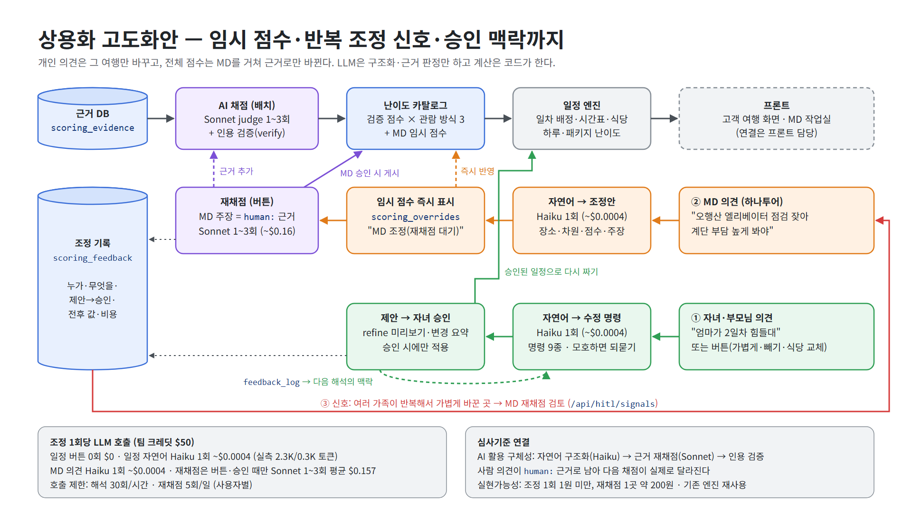

# HITL 상용화 고도화안 — 해커톤 버전에서 뺀 것과 다음 단계

> 2026-11-04 · 남재은 · 해커톤 버전은 [hitl_design.md](hitl_design.md)
> 아래 1단계 기능은 **이미 구현·테스트 완료**된 상태로 `archive/scoring-hitl-full` 브랜치(커밋 `c055630`)에 보관했다. 해커톤 시연에는 데이터가 없거나 화면에 드러나지 않아 뺐다.



## 발표용 한 문장

> "지금은 MD 의견 한 건마다 AI가 다시 채점하지만, 상용화하면 **여러 가족이 같은 관광지를 반복해서 가볍게 바꾸는 패턴을 AI가 먼저 찾아 MD에게 재검토를 요청**하고, MD 의견은 재채점 전에도 **임시 점수로 바로 반영**됩니다. 고객 수가 늘수록 난이도 데이터가 스스로 정확해지는 구조입니다."

Q&A용 보충: "사람 의견을 그대로 점수에 쓰지 않고, 근거로 넣어 AI가 웹으로 교차 확인한 뒤 MD가 승인하는 구조라 오염되지 않습니다."

## 단계별 계획

| 단계 | 기능 | 왜 해커톤에서 뺐나 | 상태 |
|---|---|---|---|
| 1 | **임시 점수 즉시 표시**: MD 의견을 재채점 전에도 "MD 조정(재채점 대기)"으로 고객 화면·일정 엔진에 반영(`scoring_overrides`) | 재채점 버튼이 있어 시연에선 단계만 늘어남 | 구현 완료(보관) |
| 1 | **반복 조정 신호**: 서로 다른 일정 3개 이상에서 같은 관광지를 short·제외로 바꾸면 MD 재채점 검토 후보(`/api/hitl/signals`) | 실제 고객 데이터가 쌓여야 작동, 시연 데이터 0 | 구현 완료(보관) |
| 1 | **승인 맥락 기억**: 승인된 요청 요약(`state.feedback_log`)을 다음 자연어 해석에 넘겨 "아까처럼" 같은 요청을 이해 | 영상에서 효과가 드러나지 않음 | 구현 완료(보관) |
| 2 | **가족 프로필 학습**: "더 걸을 수 있어요"·"덜 걸어야 해요"가 반복되면 그 가족의 보행 한도 기본값을 조정 제안 | 프로필 담당 영역, 반복 데이터 필요 | 설계만 |
| 2 | **루브릭 보정**: 승인된 MD 교정 사례를 judge 프롬프트에 예시로 넣어 전 관광지 판단 기준을 맞춤(사례가 쌓인 뒤 전체 재채점, 15곳 약 $2.4) | 사례 0건, 근거 없이 판단을 끌고 갈 위험 | 설계만 |
| 2 | **배치 재채점**: 신호가 쌓인 관광지를 야간에 모아 Batch API로 재채점(비용 50% 절감) | 실시간 시연과 무관 | 설계만 |
| 3 | **권한·감사**: MD 계정 인증(현재는 토큰 1개), 승인자 이력·되돌리기 화면, 하나투어 상품 DB 연동 | 해커톤엔 계정 체계 없음 | 설계만 |

## 1단계를 다시 켜는 방법

```bash
git checkout archive/scoring-hitl-full   # 또는 필요한 파일만 cherry-pick
```

보관 브랜치가 바꾸는 파일:
- `src/scoring/visit_modes.py`: `apply_overrides`, `load_catalog`(검증 점수 + 활성 임시 점수)
- `src/scoring/hitl.py`: `sync_overrides`(DB → `data/scoring/hitl_overrides.json`), `signals`, `lighter_places`, 승인 시 `feedback_log` 추가
- `src/planner/sources.py`·`engine.py`: 런타임 카탈로그를 `load_catalog`로, 임시 점수 안내 문구
- `src/planner/schema.py`·`feedback.py`: `PlanState.feedback_log`, 자연어 해석에 이전 승인 요청 제공
- `api/scoring.py`: 응답에 `hitl_pending`
- `tests/test_scoring_hitl.py`: 임시 점수·신호·맥락 테스트 포함 10개
- DB: `scoring_overrides` 테이블은 이미 만들어져 있음(같은 마이그레이션). 추가 마이그레이션 불필요

## 비용 전망 (상용화 규모 가정)

| 항목 | 단가(실측) | 예: 월 1,000가족 · 가족당 조정 5회 · 재채점 월 30곳 |
|---|---|---|
| 일정 자연어 해석 | 약 $0.0005/회 | 5,000회 → 약 $2.5 |
| MD 의견 해석 | 약 $0.0005/회 | 무시할 수준 |
| 재채점 | 평균 $0.157/곳 (Batch API면 약 절반) | 30곳 → 약 $4.7 |

규모 가정은 예시이며 측정값이 아니다. 단가는 2026-11-04 실측과 v2.2 재채점 실측 기준.
